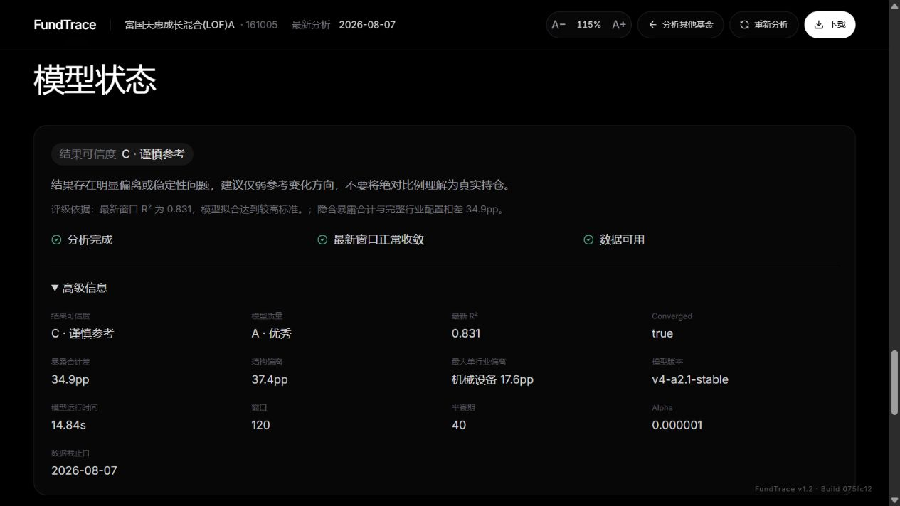
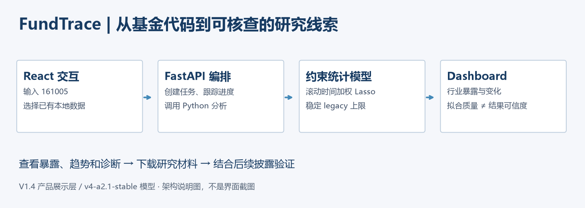
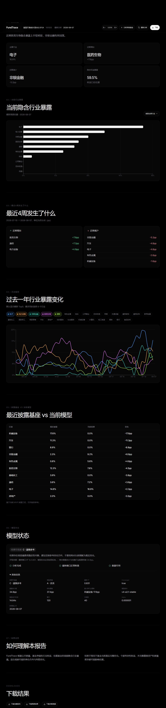
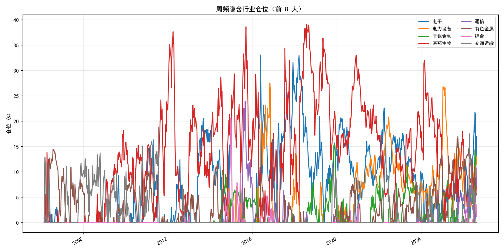

# FundTrace · 基金周频行业暴露分析

**在季度披露之间，为基金研究提供可追溯的行业配置变化线索。**

FundTrace 将基金公开披露、净值和行业收益组织成一条分析流程：先构建季度模拟组合，再估计周频隐含行业暴露，最后用 Dashboard 呈现变化、历史趋势和可信度诊断。

[真实产品界面](#真实历史运行界面) · [模型与数据详解](README_TECHNICAL.md) · [本地运行](docs/demo.md) · [公开范围](PUBLIC_SCOPE.md)

> 本仓库用于产品与技术作品集展示：提供源码、说明和已有真实历史截图，不提供在线分析服务。研究数据与 Windows 便携运行环境不随仓库分发；目前没有可直接重算历史样本的公开 Release。

## 解决什么问题

基金持仓披露是低频快照，净值和市场信息却持续变化。研究人员需要把分散数据对齐、形成可重复分析流程，并判断哪些配置变化值得进一步核查。FundTrace 把这些步骤连接成可交互产品；输出是研究线索，不是实时真实持仓。

## 从数据到 Dashboard

这是一张流程说明图；其余三张图片来自真实历史运行。

| 步骤 | 实现与输出 |
|---|---|
| 数据准备 | 清洗基金净值、披露持股及行业收益；统一日期、代码与行业映射 |
| 模型估计 | 季度模拟组合 + 周频滚动约束回归，估计收益口径的行业暴露 |
| 可信度诊断 | 分别呈现收益拟合、求解收敛、暴露合计偏差与结果参考等级 |
| 产品呈现 | 当前行业暴露、近四周变化、历史曲线、披露基座对比及报告/CSV 下载 |

Python / Pandas / NumPy 处理数据与模型；FastAPI 编排本地任务并提供结果接口；React / Recharts 负责交互和图表。模型与技术取舍见 [技术详解](README_TECHNICAL.md)、[方法说明](docs/methodology.md) 和 [技术核验](docs/technical_audit.md)。

## 真实历史运行界面

案例基金 **161005**，周频标签截至 **2026-08-07**，行业指数输入截至 **2026-08-05**。这些截图不代表当前市场数据。

完整 Dashboard：行业暴露、近期变化、历史趋势与诊断

历史行业暴露曲线

案例的最新窗口收益拟合 R² 约 **0.831**，模型质量为 A；隐含暴露合计仍与披露配置相差 **34.9pp**，因此结果可信度为 **C：谨慎参考**。拟合好不等于恢复真实持仓，界面保留这一区别。

## 如何查看与运行

- **快速了解产品：**直接查看本 README 的图片与流程，以及 [运行说明](docs/demo.md)。
- **自行运行源码：**按 [docs/demo.md](docs/demo.md) 准备环境和有权使用的数据。Public 仓库不含 base/funds/output 研究数据，clone 后不能直接离线重算 161005。
- **Windows 下载：**目前不提供含历史样本的公开便携包。内部本机展示包虽已通过流程验收，但数据再分发范围与完整运行库许可义务尚未确认，未创建 Release，也没有提供虚假下载链接。

## 能说明什么，不能说明什么

- 证明已有数据处理、受约束模型、交互 Dashboard 和诊断流程；单基金流程验收不证明多基金泛化能力。
- 行业系数是收益口径估计，可能受行业相关性、遗漏资产、个股特异性收益和披露差异影响。
- 不是未来收益预测或投资建议；没有宣称实盘收益、机构生产部署、用户节省工时或业务增益。
- 参数、诊断规则、历史测试记录与跳过项见 [技术详解](README_TECHNICAL.md) 和 [validation.md](docs/validation.md)，历史测试不冒充本轮重新运行。

源码源于 V1.4 产品分支（075fc12），原开发成果保留。四张既有公开图片复用原文件；不新增研究数据、第三方视频、运行库二进制或 Git 历史。范围说明见 [PUBLIC_SCOPE.md](PUBLIC_SCOPE.md)。
